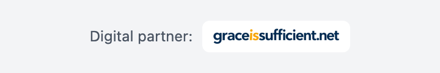

# graceissufficient-badge

The **"Digital partner: graceissufficient.net"** footer credit as one shared
React component. Every project installs it from this repo, so the logo, link
and wording are kept in one place.

**On a dark footer** (the Catholicans background, `#16122b`):


**On a light footer** (`#f3f4f6`):



The logo sits on a white chip and links to https://graceissufficient.net.

## Contents

- [What's in the package](#whats-in-the-package)
- [Requirements](#requirements)
- [Quick start](#quick-start)
- [Installation](#installation)
- [Usage](#usage)
- [Props](#props)
- [Styling](#styling)
- [Other kinds of project](#other-kinds-of-project)
- [Releasing a new version](#releasing-a-new-version)
- [Updating a project to a new version](#updating-a-project-to-a-new-version)
- [Troubleshooting](#troubleshooting)
- [Projects using it](#projects-using-it)

---

## What's in the package

| File                     | Purpose                                                        |
| ------------------------ | -------------------------------------------------------------- |
| `index.jsx`              | The `PartnerBadge` component (default export)                  |
| `graceissufficient.webp` | The wordmark logo, 420 × 56 px, about 10 KB                    |
| `package.json`           | Name, version, and `react` as a peer dependency                |
| `README.md`              | This file                                                      |
| `docs/`                  | README screenshots (in the repo only, not installed)           |

The component renders this HTML:

```html
<span lang="en" style="display:inline-flex; align-items:center; gap:0.5rem">
  Digital partner:
  <a href="https://graceissufficient.net" target="_blank" rel="noopener noreferrer"
     style="display:inline-flex; background:#fff; border-radius:0.375rem; padding:0.375rem 0.5rem">
    
  </a>
</span>
```

- **Default text:** "Digital partner:". You can replace it with the `label` prop.
- **Link:** Opens graceissufficient.net in a new tab. `noopener noreferrer`
  stops the opened site from getting access back to your page.
- **Image size:** `width` and `height` give the browser the aspect ratio, so the
  layout doesn't jump while the logo loads.
- **Language:** `lang="en"` marks the credit as English, even on a page in
  another language (Malayalam, for example).
- **No CSS needed:** All styles are inline, so no Tailwind or stylesheet setup
  is required.

## Requirements

- **React** 18 or newer. It's a peer dependency, so the project's own React is
  used.
- **A bundler that compiles `.jsx` and imports `.webp` files from packages.**
  Vite does this with no setup. Next.js needs
  [one config line](#nextjs).
- **Access to this private repo.** It must be readable by whoever (or whatever)
  runs `npm install`. See [Private repo access](#private-repo-access).

## Quick start

```bash
npm install github:smartincherian/graceissufficient-badge#v1.0.0
```

```jsx
import PartnerBadge from 'graceissufficient-badge';

<footer>
  <PartnerBadge />
</footer>
```

## Installation

### From GitHub (normal way)

Run this in the project folder:

```bash
npm install github:smartincherian/graceissufficient-badge#v1.0.0
```

This adds the following to `package.json`:

```json
"graceissufficient-badge": "github:smartincherian/graceissufficient-badge#v1.0.0"
```

- **Always pin a tag** (`#v1.0.0`). Without a tag, npm records whatever commit
  was latest at install time, so a later change to `main` could reach a
  project unnoticed.
- **Available tags:** see https://github.com/smartincherian/graceissufficient-badge/tags

### Private repo access

npm fetches the repo with Git, so it needs GitHub access:

- **Your own computer:** This already works if `gh auth status` shows you're
  logged in, or if `git clone https://github.com/smartincherian/graceissufficient-badge`
  works without asking for a password.
- **Another computer:** Run `gh auth login` once, then `gh auth setup-git`.
- **CI or hosted builds** (GitHub Actions, Vercel, Netlify, Cloud Build):
  1. Create a fine-grained personal access token with **read-only Contents**
     access to this repo.
  2. Add it to the build as a secret, for example `GH_TOKEN`.
  3. Before `npm install`, run:
     ```bash
     git config --global url."https://${GH_TOKEN}@github.com/".insteadOf "https://github.com/"
     ```
- **Not needed for `firebase deploy`:** It uploads the `dist/` folder that was
  built on your computer, so the build server never fetches this repo.

### From a local folder (offline or testing)

Use this only while trying out changes before pushing them:

```bash
echo "install-links=true" >> .npmrc      # required, see Troubleshooting
npm install ../graceissufficient-badge
```

Switch back to the GitHub install before committing the project. A `file:`
path only works on the computer where that folder exists.

## Usage

### Default

```jsx
import PartnerBadge from 'graceissufficient-badge';

export default function Footer() {
  return (
    <footer style={{ fontSize: 12, color: 'rgba(255,255,255,.6)' }}>
      <PartnerBadge />
    </footer>
  );
}
```

This shows **"Digital partner:"** followed by the logo.

### With your own text (for example, translated)

```jsx
<PartnerBadge label={t('footer.madeBy')} />
```

When you pass `label`, the package's default text isn't used. If you later
change the default wording in this package, a project that passes its own
`label` keeps showing its own text.

### Footer layout example (Tailwind)

This is the footer layout used in Catholicans. The project's text sits on one
side and the badge on the other. They stack in the centre on phones.

```jsx
<footer className="mx-auto flex max-w-5xl flex-col items-center gap-3 border-t border-white/10 px-4 py-6 text-xs text-white/60 sm:flex-row sm:justify-between">
  <span>An initiative of Catholicans</span>
  <PartnerBadge />
</footer>
```

## Props

| Prop        | Type                  | Default              | Description                                             |
| ----------- | --------------------- | -------------------- | ------------------------------------------------------- |
| `label`     | `ReactNode`           | `"Digital partner:"` | Text (or any element) shown before the logo             |
| `className` | `string`              | none                 | Classes added to the outer `<span>`                     |
| `style`     | `React.CSSProperties` | none                 | Inline styles merged over the outer `<span>` defaults   |

`style` only affects the outer `<span>`. The logo chip and image keep their own
fixed styles.

## Styling

- **Text colour and size** are inherited from the parent element. Set them on
  the footer, or pass `className` or `style`.
- **The logo chip is always white.** It looks best on dark or coloured
  backgrounds. On a white page, give the footer a light grey background (for
  example `#f3f4f6`) so the chip stays visible.
- **Spacing:** Change the gap between the text and the chip with
  `style={{ gap: '0.75rem' }}`.
- **Screenshots:** If the look changes, retake `docs/badge-dark.png` and
  `docs/badge-light.png` (720 × 120 px, 2× scale).
- **Logo size:** The logo is 14 px tall, which suits 12–14 px footer text. To
  change it, edit `height` in `index.jsx` and release a new version.

## Other kinds of project

### Next.js

Next doesn't compile packages that ship raw JSX unless you tell it to. Add this
to `next.config.js` (or `.mjs`):

```js
const nextConfig = { transpilePackages: ['graceissufficient-badge'] };
export default nextConfig;
```

The component uses no hooks or browser APIs, so it works in both Server and
Client Components.

> **Not yet tested with Next.js.** Next.js turns an image import into an
> object (`{ src, width, height }`), not a URL string, so in v1.0.0 the logo
> would render as `src="[object Object]"`. Before you use the badge in a
> Next.js project, release a version where `index.jsx` uses
> `typeof wordmark === 'string' ? wordmark : wordmark.src`.

### Plain HTML, WordPress, or static sites (no React)

Copy `graceissufficient.webp` into the site and paste this where the credit
should appear:

```html
<span lang="en" style="display:inline-flex;align-items:center;gap:.5rem">Digital partner:
  <a href="https://graceissufficient.net" target="_blank" rel="noopener noreferrer"
     style="display:inline-flex;background:#fff;border-radius:.375rem;padding:.375rem .5rem">
    
  </a></span>
```

These copies don't update by themselves. When `index.jsx` changes, update
this snippet and the sites that use it.

### React Native or Expo

Not supported, because the component renders HTML elements. Rebuild the same
layout with `<View>`, `<Text>` and `<Image>`, and open the link with
`Linking.openURL('https://graceissufficient.net')`.

## Releasing a new version

1. Make the change in `index.jsx`, or replace `graceissufficient.webp`. If you
   rename the image, also update the import in `index.jsx` and the `files`
   list in `package.json`.
2. Test it in one project with a [local-folder install](#from-a-local-folder-offline-or-testing).
3. Bump `version` in `package.json`:
   - **Patch** (`1.0.1`) for fixes.
   - **Minor** (`1.1.0`) for new optional props or a look-alike tweak.
   - **Major** (`2.0.0`) if projects must change their code.
4. Commit, tag and push both the commit and the tag:
   ```bash
   git commit -am "Badge: <what changed>"
   git tag v1.1.0
   git push && git push origin v1.1.0
   ```
5. Add the change to the [changelog](#changelog) below.

## Updating a project to a new version

Run this in each project:

```bash
npm install github:smartincherian/graceissufficient-badge#v1.1.0
```

Then build and redeploy it. `npm update` doesn't move a pinned tag. You have to
install the new tag.

## Troubleshooting

| Problem | Cause and fix |
| ------- | ------------- |
| Build fails: `failed to resolve import "react/jsx-runtime"` | The package was installed from a local folder as a symlink. Add `install-links=true` to the project's `.npmrc` and reinstall, or use the GitHub install. |
| `npm install` fails: `Permission denied`, `Repository not found` or `could not read Username` | No access to the private repo. See [Private repo access](#private-repo-access). |
| Next.js: `Unexpected token '<'` or `Module parse failed` | Add the package to `transpilePackages` ([Next.js](#nextjs)). |
| Next.js: logo is broken (`src="[object Object]"`) | Known v1.0.0 limitation, see [Next.js](#nextjs). |
| The badge text didn't change after updating the package | The project passes its own `label`. Change it in the project, or remove the prop to use the package default. |
| The logo chip is invisible | The footer background is white. Give it a light grey or dark background. |
| A change pushed to the repo doesn't appear in a project | The project is pinned to an older tag. Release a new tag and install it ([Updating](#updating-a-project-to-a-new-version)). |

## Projects using it

| Project       | Where                            | Version  | Label                              |
| ------------- | -------------------------------- | -------- | ---------------------------------- |
| `catholicans` | `src/components/Footer.jsx`      | `v1.0.0` | Own (`footer.madeBy` locale key)   |

Add a row when you add the badge to another project.

## Changelog

### v1.0.0 — 2026-10-29

- First release: `PartnerBadge` with `label`, `className` and `style` props,
  and the bundled `graceissufficient.webp` logo.
